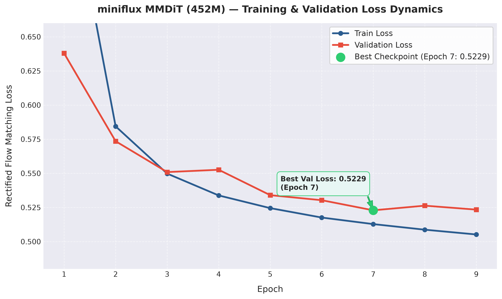
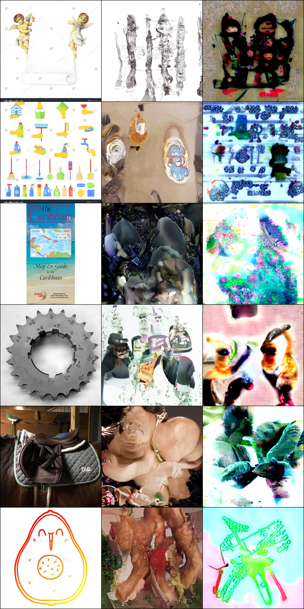
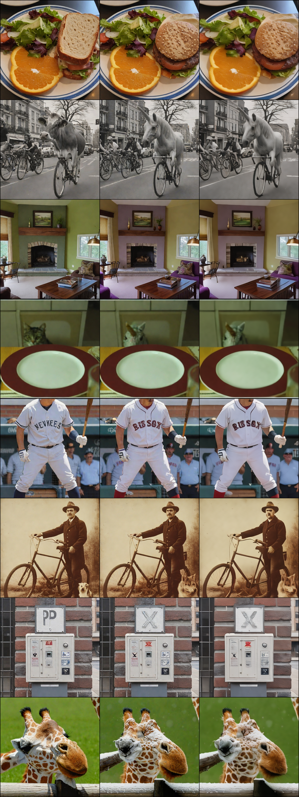

```text
              d8b          d8b  .d888 888                    
              Y8P          Y8P d88P"  888                    
                               888    888                    
88888b.d88b.  888 88888b.  888 888888 888 888  888 888  888 
888 "888 "88b 888 888 "88b 888 888    888 888  888 `Y8bd8P' 
888  888  888 888 888  888 888 888    888 888  888    X88K   
888  888  888 888 888  888 888 888    888 Y88b 888 .d8""8b. 
888  888  888 888 888  888 888 888    888  "Y88888 888  888
```

**miniflux** is a compact 450M-parameter Multimodal Diffusion Transformer (MMDiT) built completely from scratch using Rectified Flow Matching. Heavily inspired by the generative architecture of the FLUX model family, miniflux is designed to explore high-efficiency generative modeling, custom fused-stream block designs, and in-context conditioning under realistic consumer-hardware constraints (single NVIDIA RTX 5070 12GB).

## Technical Highlights

- **Rectified Flow & Advanced Sampling:** Employs Logit-Normal timestep sampling ($\mu=0, \sigma=1$) paired with non-linear Timestep Shifting (Time Warping) to allocate computational density toward fine-grained trajectory resolution.
- **Refactored Fused Block Architecture:** Re-engineered the standard MMDiT layout by introducing Fused Feed-Forward Networks into both Single-Stream and Double-Stream blocks to maximize operation fusion and CUDA kernel execution throughput.
- **Compact Multimodal Conditioning:** Utilizes a lightweight text-encoder pairing, OpenAI CLIP-ViT-Base-Patch32 ($d=512$) and Google T5 1.1 Base ($d=768$), providing efficient yet expressive text embeddings as a substitute for massive LLM backbones.
- **Context & Image-to-Image Readiness:** Built-in native support for multiple visual tokens (`max_cond_images`), implementing the sequence-level conditioning paradigm (similar to FLUX.1-Kontext) for future Image-to-Image and context-guided fine-tuning.
- **Flux.2 VAE Latent Alignment:** Integrated the official Flux.2 32-channel VAE with custom BatchNorm-based latent denormalization for optimal latent space spatial compression ($8\times$ spatial reduction, 32 latent channels).

## Architectural Specifications

| Component | Specification / Value | Notes |
|---|---|---|
| Total Parameters | ~452M | Full-model trainable weights |
| Hidden Dimension ($d_{model}$) | 768 | Uniform inner projection size |
| Attention Heads ($h$) | 12 | 64 dim per head |
| Single-Stream Blocks | 30 | Shared sequence processing |
| Double-Stream Blocks | 5 | Dual multimodal fusion (1:6 stream ratio) |
| Positional Embedding | RoPE2D | 2D Rotary Embeddings over spatial tokens |
| Feed-Forward Layers | SwiGLU | Bias-free linear layers with SiLU gating |
| VAE Latent Representation | 32 × H/8 × W/8 | Flux.2 VAE Integration |
| Patch Size | $2 \times 2$ | Spatial tokenization step |
| Text Conditioning | CLIP-ViT-Base ($d=512$) + T5 1.1 Base ($d=768$) | Pooled EOS token + sequence hidden states |

## Dataset & Training Setup

The training pipeline processes a curated subset of CC12M (~500,000 text-image pairs) pre-encoded into HDF5 (`.h5`) datasets. While the codebase features native multi-bucket scheduling across multiple aspect ratios, active training is executed at a fixed $512 \times 512$ resolution to maximize execution throughput on consumer GPU hardware.

### Dataset Splits & Bucketing

| Bucket Resolution | Dataset Purpose | Sample Count | Format |
|---|---|---|---|
| $512 \times 512$ | Active Training / Evaluation | 152.661 Train / 1,000 Val | HDF5 (`.h5`) |
| $768 \times 512$ | Multi-Bucket Codebase Support | 122.456 Train / 1,000 Val | HDF5 (`.h5`) |
| $512 \times 768$ | Multi-Bucket Codebase Support | 221.888 Train / 1,000 Val | HDF5 (`.h5`) |

**Pre-encoded Latents Dataset:** Available on Hugging Face at [christian-tarantino/cc12m-500k-encoded](https://huggingface.co/datasets/christian-tarantino/cc12m-500k-encoded).

---

## Training Dynamics & Qualitative Results 

### Training Loss Curve & Convergence Analysis
The model was trained for 9 epochs on the 512x512 bucket subset (~152k samples). The Rectified Flow loss achieved a stable downward trend, hitting a validation loss plateau around **0.5229** at **Epoch 7** .


*Fig. 2: Train vs. Validation Loss curves across 9 epochs, highlighting the Epoch 7 minimum.*

### Qualitative Sampling & CFG Ablation Study
To evaluate trajectory guidance, samples were generated using non-linear timestep shifting ($\text{shift}=1.5$) over 50 sampling steps, comparing Unconditional generation against Classifier-Free Guidance (CFG).

<table>
<thead>
<tr>
<th align="center" width="33%">Ground Truth ($x_0$)</th>
<th align="center" width="33%">Unconditional ($v_{uncond}$)</th>
<th align="center" width="33%">Text-Guided CFG ($v_{text}$)</th>
</tr>
</thead>
<tbody>
<tr>
<td colspan="3" align="center">

</td>
</tr>
</tbody>
</table>

*Fig. 3: Qualitative comparison at 512x512 resolution (Epoch 7 checkpoint). Left: Ground Truth latents decoded via Flux.2 VAE; Center: Unconditional diffusion trajectory; Right: Text-guided CFG trajectory.*
### Ablation Study: Training Constraints & Architectural Trade-offs

Training a 452M-parameter Multimodal Diffusion Transformer from scratch on consumer hardware (NVIDIA RTX 5070 12GB) involves navigating strict throughput and optimization boundaries. To balance execution speed (~9 samples/sec) with gradient stability within a realistic compute window, the active training partition was restricted to approximately 152k samples for the primary 512x512 bucket.

A primary architectural challenge stems from the integration of the official Flux.2 32-channel VAE. Compared to traditional 4-channel or 16-channel representations, these 32-channel latents are significantly more information-dense and rich in fine-grained spatial features. Predicting such a high-dimensional continuous target under Rectified Flow matching exponentially increases the learning complexity for a 450M-parameter backbone. Furthermore, training directly on a raw, heterogeneous web-scale source like CC12M introduces substantial domain noise and uncurated alt-texts, causing an information-entropy saturation where validation loss naturally plateaus around ~0.5229.

Ultimately, while the refactored architecture successfully implements fused multi-stream processing and sequence-level visual conditioning (inspired by FLUX.1 Kontext), the 450M-parameter capacity limit restricts its ability to map millions of highly disparate semantic concepts without prior large-scale foundational pre-training. As a result, the model demonstrates strong convergence on global spatial geometry, color dynamics, and structural layout, while exhibiting expected capacity constraints in fine-grained compositional text alignment.
...
## Educational VAE Exploration (Preliminary R&D)

> **Architectural Note:** While the core `miniflux` pipeline relies on the official 32-channel Flux.2 VAE for production latent alignment, this section documents an **isolated preliminary study**. A custom Autoencoder (LPIPS + GAN + KL) was built from scratch to analyze latent space dynamics and reconstruction behavior on 10,000 images from the UltraEdit dataset prior to integrating the Flux.2 VAE.

### Experimental VAE Convergence Metrics (Custom Scratch Baseline)

| Metric Category | Metric | Final Value | Notes |
|---|---|---|---|
| Loss Terms | Total Validation Loss | 0.2489 | Val split evaluation |
| | Train Loss (Total) | 0.2789 | Combined loss objective |
| | L1 Reconstruction Loss | 0.0606 | Pixel-space fidelity |
| | LPIPS Perceptual Loss | 0.2325 | Feature-space alignment |
| | Adversarial Loss (Discriminator) | 0.3231 (Disc Loss: 0.2186) | PatchGAN discriminator |
| | KL Divergence Weight ($\beta$) | $1.00 \times 10^{-5}$ (Raw KL: 6966.3380) | Latent regularization |
| Latent Statistics | Absolute Mean | 0.4521 | Latent distribution offset |
| | Log-Variance Mean | -0.8563 | Variance scaling |

### Qualitative Validation Split Results

<table>
<thead>
<tr>
<th align="center" width="33%">Input Image</th>
<th align="center" width="33%">Target Image (Ground Truth)</th>
<th align="center" width="33%">VAE Reconstruction</th>
</tr>
</thead>
<tbody>
<tr>
<td colspan="3" align="center">

</td>
</tr>
</tbody>
</table>

*Fig. 1: Qualitative reconstruction comparison at 512x512 resolution on the UltraEdit validation split.*

##  Checkpoints & Resources

- **miniflux MMDiT Weights:** [christian-tarantino/miniflux](https://huggingface.co/christian-tarantino/miniflux) — Core 450M Rectified Flow Transformer checkpoint.
- **Flux.2 VAE Weights:** Available on [Hugging Face](https://huggingface.co/black-forest-labs/flux-3-image-klein-comfy/tree/main/vae) (Official Black Forest Labs 32-channel VAE).
- **Experimental VAE Weights:** [christian-tarantino/vae_ultraedit](https://huggingface.co/christian-tarantino/vae_ultraedit/) — Custom LPIPS + GAN + KL Autoencoder trained on UltraEdit.
- **Pre-encoded Training Datasets:** [christian-tarantino/cc12m-500k-encoded](https://huggingface.co/datasets/christian-tarantino/cc12m-500k-encoded) — Pre-processed HDF5 dataset (~500k text-image latents).

##  Repository Structure

```text
.
├── flux/
│       └── flux2_vae.safetensors  # Pretrained Flux.2 VAE weights
├── dataset/
│   └── *.h5                        # Pre-encoded HDF5 dataset files
├── model/
│   ├── model.py                    # Custom PyTorch MMDiT (RoPE2D, SwiGLU, AdaLN)
│   └── vae_model.py                # Standalone experimental VAE architecture
├── train.py                        # Main training pipeline (Rectified Flow, compilation, multi-bucket)
├── train_vae.py                    # Standalone training script for experimental VAE
├── vae_extractor.py                # Pre-processing utility for encoding images to HDF5
├── requirements.txt                # Python package dependencies
└── README.md                       # Project documentation
```
